<h1 align="center">AI Sales Intelligence Platform<br/>LLM Gateway</h1>

<p align="center">
  <strong>The layer that kept a production AI sales platform reliable, safe and observable, rebuilt from scratch as an open showcase.</strong><br />
  <i>How do you put an LLM in front of real users without it falling over, leaking customer data or blowing the budget?</i>
</p>

<div align="center">

[![Python][badge-python]](#quick-start)
[![FastAPI][badge-fastapi]](#component-5-the-fastapi-app)
[![Pydantic][badge-pydantic]](#api-reference)
[![pytest][badge-pytest]](#testing)
[![Docker][badge-docker]](#deployment)
[![GitHub Actions][badge-gha]](#cicd)
[![AWS][badge-aws]](#deployment)

</div>

<p align="center">
  <a href="#tldr">Overview</a> ·
  <a href="#the-platform">Platform</a> ·
  <a href="#gateway-architecture">Architecture</a> ·
  <a href="#component-1-token-bucket-rate-limiter">Components</a> ·
  <a href="#testing">Testing</a> ·
  <a href="#cicd">CI/CD</a> ·
  <a href="#my-contributions">My contributions</a>
</p>

<p align="center">
  
  
  
  
  <a href="https://github.com/medhairya/ai-sales-intelligence-showcase/actions/workflows/ci.yml"></a>
  <a href="https://github.com/medhairya/ai-sales-intelligence-showcase/commits/main"></a>
</p>

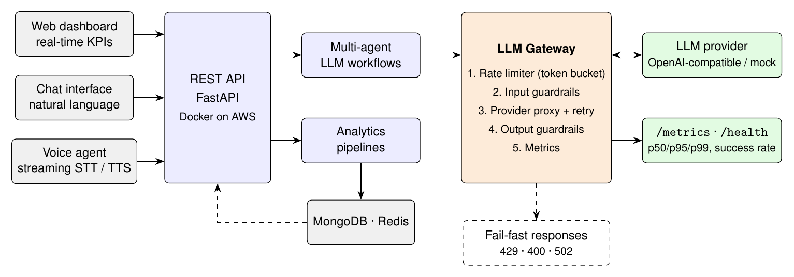

*Platform overview. Web, chat and voice clients call one FastAPI backend. Every LLM call from the multi-agent workflows goes through the **LLM Gateway**: rate limiting, input guardrails, a provider proxy with retries, output guardrails and metrics. Requests that should not reach the model fail fast with 429 / 400 / 502. The gateway (orange) is the part published in this repo.*

[badge-python]: https://img.shields.io/badge/Python_3.11+-3776AB?style=for-the-badge&logo=python&logoColor=white
[badge-fastapi]: https://img.shields.io/badge/FastAPI-009688?style=for-the-badge&logo=fastapi&logoColor=white
[badge-pydantic]: https://img.shields.io/badge/Pydantic-E92063?style=for-the-badge&logo=pydantic&logoColor=white
[badge-pytest]: https://img.shields.io/badge/pytest-0A9EDC?style=for-the-badge&logo=pytest&logoColor=white
[badge-docker]: https://img.shields.io/badge/Docker-2496ED?style=for-the-badge&logo=docker&logoColor=white
[badge-gha]: https://img.shields.io/badge/GitHub_Actions-2088FF?style=for-the-badge&logo=githubactions&logoColor=white
[badge-aws]: https://img.shields.io/badge/AWS-232F3E?style=for-the-badge&logo=amazonwebservices&logoColor=white

> [!NOTE]
> **About this repo.** I designed and delivered an AI-driven sales intelligence and employee management platform for a **manufacturing client**. That codebase is proprietary, so this repository is a **clean-room reimplementation** of one of its core components, the **LLM gateway**. It was written from scratch and contains **no client code, data, names or credentials**. It shows how the production system was engineered: architecture, testing, CI/CD and reliability practices.

## TL;DR

| | |
|---|---|
| **Problem** | A sales platform where dashboards, a chat assistant and a voice agent all call an LLM. Every call costs money, adds latency, can fail upstream, and can leak customer PII |
| **Approach** | One **gateway** that every LLM call goes through: per-client **token-bucket rate limiting**, **input/output guardrails**, a **provider-agnostic proxy** with exponential-backoff retries, and **live metrics** |
| **Production outcome** | **99.5% uptime**. Automated reporting cut **manual effort by ~60%** |
| **This repo** | FastAPI service · **25 unit tests, 96% coverage** · Ruff lint · Docker · GitHub Actions CI with a container smoke test |
| **Runs offline** | Uses a deterministic mock LLM by default, so you can clone, test and run with **no API key** |
| **Key insight** | Reliability in LLM apps is mostly ordinary backend engineering: rate limits, timeouts, retries, validation and observability around an unreliable dependency |

---

## Why an LLM needs a gateway

Calling an LLM API directly from application code works in a demo. In production it causes four problems:

| Risk | What happens without a gateway |
|---|---|
| **Cost & quota** | A retry loop, a bot or one heavy user burns the provider quota, and every other user gets errors |
| **Availability** | The provider times out or returns 5xx. Without retries the user sees a failure; with naive retries you amplify the outage |
| **Data leakage** | Customer emails and phone numbers in prompts are sent to a third party, and the model can echo them back |
| **Prompt injection** | "Ignore all previous instructions…" reaches the model unfiltered |
| **Blind spots** | Nobody knows the error rate or p95 latency until users complain |

**Core idea:**

> Treat the LLM like any other **unreliable, expensive, third-party dependency**. Put one well-tested layer in front of it that enforces limits, validates input and output, absorbs transient failures, and measures everything.

### Design principles

1. **One choke point.** Every LLM call goes through the gateway. No module talks to a vendor SDK directly.
2. **Fail fast and cheap.** Reject bad or excess requests *before* paying for a model call.
3. **Depend on interfaces, not vendors.** The provider, the limiter and the settings are all injected, so tests and CI run fully offline.
4. **Measure by default.** Every request updates counters and latency percentiles.

---

## The platform

How the gateway fits into the full client platform. Component names are generic. No client systems, schemas or data are shown.

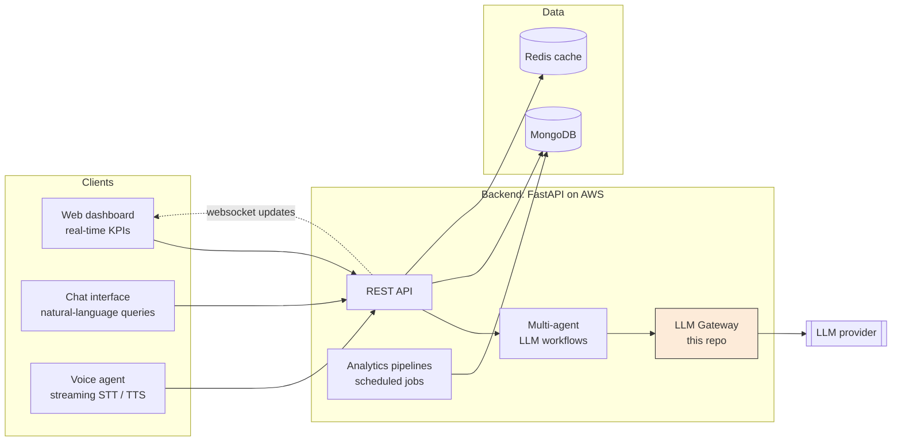

| Module of the platform | What it did |
|---|---|
| **Real-time dashboards** | Sales performance, attendance and territory KPIs, pushed live to the browser |
| **Analytics pipelines** | Scheduled jobs for performance monitoring, territory-risk analysis and executive reports |
| **Chat interface** | ChatGPT-style assistant backed by multi-agent LLM workflows |
| **Voice agent** | Conversational agent for lead generation and CRM workflows, with streaming speech-to-text and text-to-speech |
| **LLM gateway** | Rate limiting, guardrails, proxy and monitoring for all of the above (**published here**) |

---

## Gateway architecture

Every `POST /v1/chat` request passes through the same five stages. Cheap checks run first, so a rejected request never costs a model call.

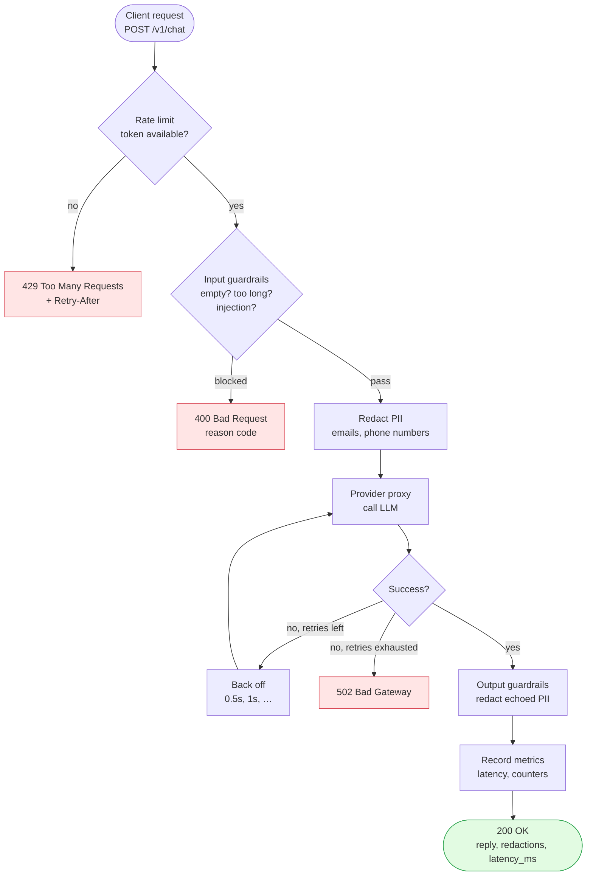

### Request lifecycle

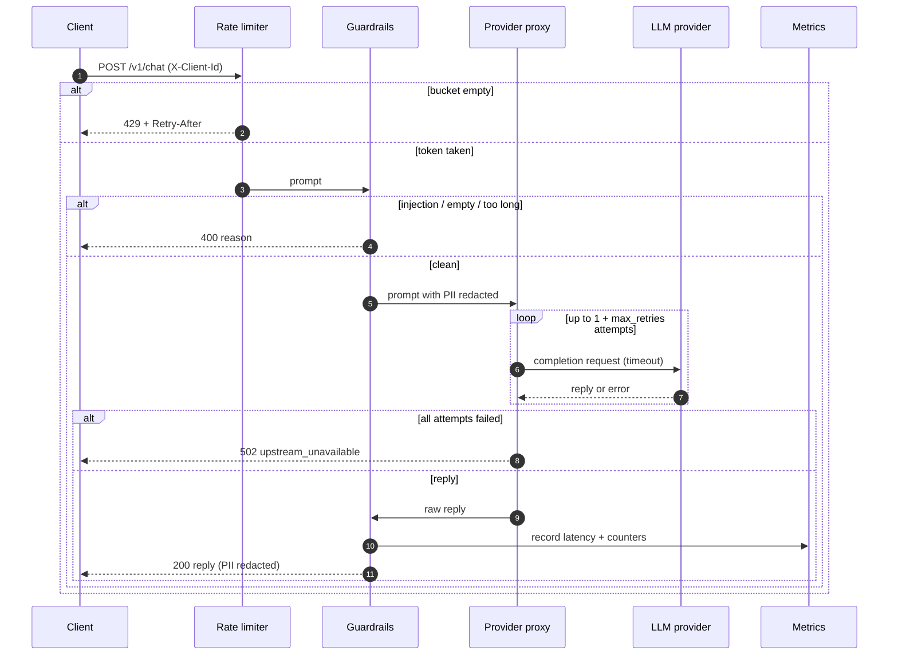

---

## Component 1: Token-bucket rate limiter

`app/rate_limiter.py`

Each client (identified by the `X-Client-Id` header, falling back to IP) gets a bucket that holds up to $C$ tokens and refills continuously at $r$ tokens per second. A request costs one token.

$$
\text{tokens}(t) = \min\big(C,\ \text{tokens}(t_0) + r\,(t - t_0)\big), \qquad
\text{Retry-After} = \frac{1 - \text{tokens}}{r}
$$

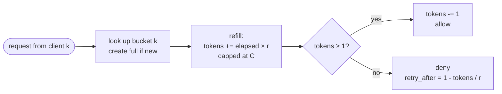

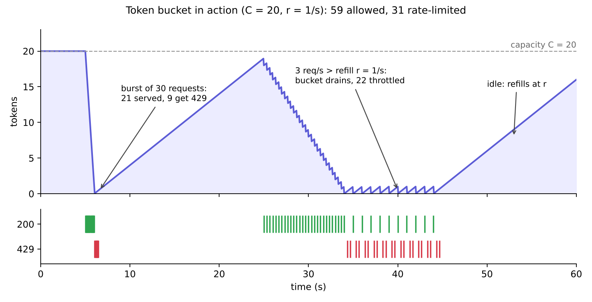

*Generated by driving the real `TokenBucketLimiter` with a fake clock (`assets/src/token_bucket_plot.py`). A burst is absorbed up to capacity. Sustained traffic above the refill rate is smoothed. Idle time refills the bucket.*

| Property | How it is achieved |
|---|---|
| **Bursts allowed, sustained rate capped** | Capacity $C$ absorbs bursts; refill rate $r$ caps the long-run rate |
| **No window-edge spikes** | Continuous refill, unlike fixed windows that allow 2× traffic at a boundary |
| **Per-client isolation** | One bucket per key, so a noisy client can't starve others |
| **Thread-safe** | A single lock around refill + take |
| **Testable** | The clock is injected, so tests move time forward deterministically |
| **Scales out** | `RateLimiter` is a `Protocol`. A Redis-backed version can replace the in-memory one for several instances |

**Why a token bucket?**

| Algorithm | Burst handling | Edge spikes | Memory per client |
|---|---|---|---|
| Fixed window | Poor | Up to 2× at window boundary | 1 counter |
| Sliding log | Exact | None | One timestamp per request |
| **Token bucket** | **Configurable** | **None** | **2 numbers** |

---

## Component 2: Guardrails

`app/guardrails.py`

Checks run **in both directions**. Input is validated and cleaned before it leaves the network, and output is cleaned before it reaches the user, because models can repeat data from their context.

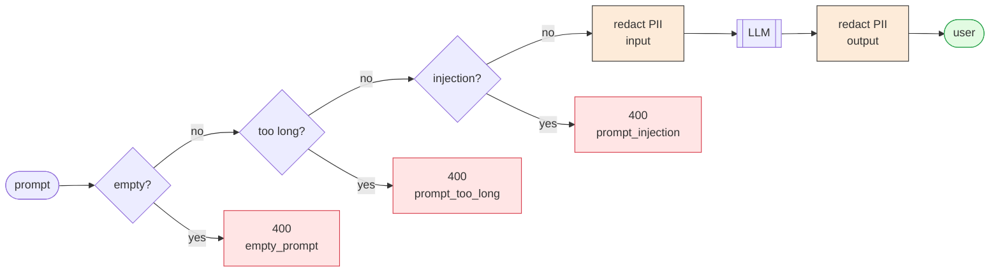

| Check | Direction | Action | Example |
|---|---|---|---|
| Empty / whitespace prompt | in | `400 empty_prompt` | `"   "` |
| Oversized prompt | in | `400 prompt_too_long` | > 4,000 chars (configurable) |
| Prompt injection | in | `400 prompt_injection` | *"Ignore all previous instructions…"* |
| Email address | in + out | replaced with `[EMAIL]` | `priya@example.com → [EMAIL]` |
| Phone number | in + out | replaced with `[PHONE]` | `+91 98765 43210 → [PHONE]` |

Ordinary numbers in business text (*"4520 units across 12 territories"*) are deliberately **not** redacted. There is a test for this.

---

## Component 3: Provider proxy with retries

`app/llm_client.py`

The gateway only knows the `LLMProvider` interface. `MockProvider` is used for local runs and CI, and `OpenAIProvider` calls any OpenAI-compatible endpoint. Transient failures are retried with **exponential backoff**:

$$
\text{delay}_k = 0.5\text{ s} \times 2^{k}, \qquad k = 0, 1, \dots, R - 1 \quad (R = \text{max retries})
$$

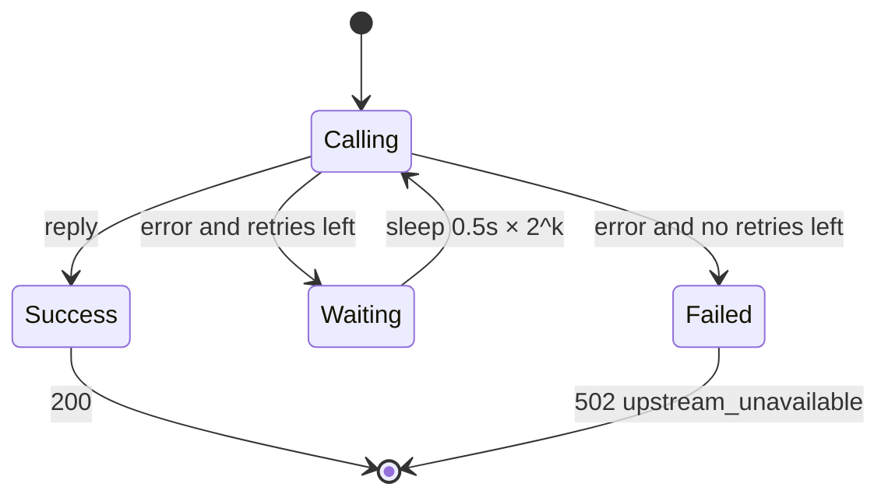

With the default `UPSTREAM_MAX_RETRIES=2`, a call gets **3 attempts** with waits of **0.5 s then 1 s**. That rides out short provider blips without piling extra load onto a provider that is fully down.

---

## Component 4: Monitoring

`app/monitoring.py`

Every request updates thread-safe counters and a rolling window of latencies. `GET /metrics` returns a snapshot:

```json
{
  "counters": {
    "requests_total": 1250,
    "requests_ok": 1196,
    "rate_limited": 31,
    "guardrail_blocked:prompt_injection": 4,
    "upstream_errors": 2,
    "pii_redactions": 87
  },
  "success_rate": 0.9568,
  "latency_ms": { "p50": 812.4, "p95": 2140.9, "p99": 3302.1 }
}
```
*(Illustrative numbers.)*

| Signal | Why it matters |
|---|---|
| `success_rate` | Headline reliability number to alert on |
| `rate_limited` | Shows whether limits are too tight or a client is misbehaving |
| `guardrail_blocked:*` | Shows abuse attempts and false positives |
| `upstream_errors` | Separates provider outages from our own bugs |
| `p95` / `p99` latency | Tail latency is what users actually feel |

In production these feed a metrics backend and alerts. Here they are exposed as JSON so they're easy to inspect.

---

## Component 5: The FastAPI app

`app/main.py`

`create_app()` builds the app from injected parts. Production uses real settings from the environment, and tests pass in fakes.

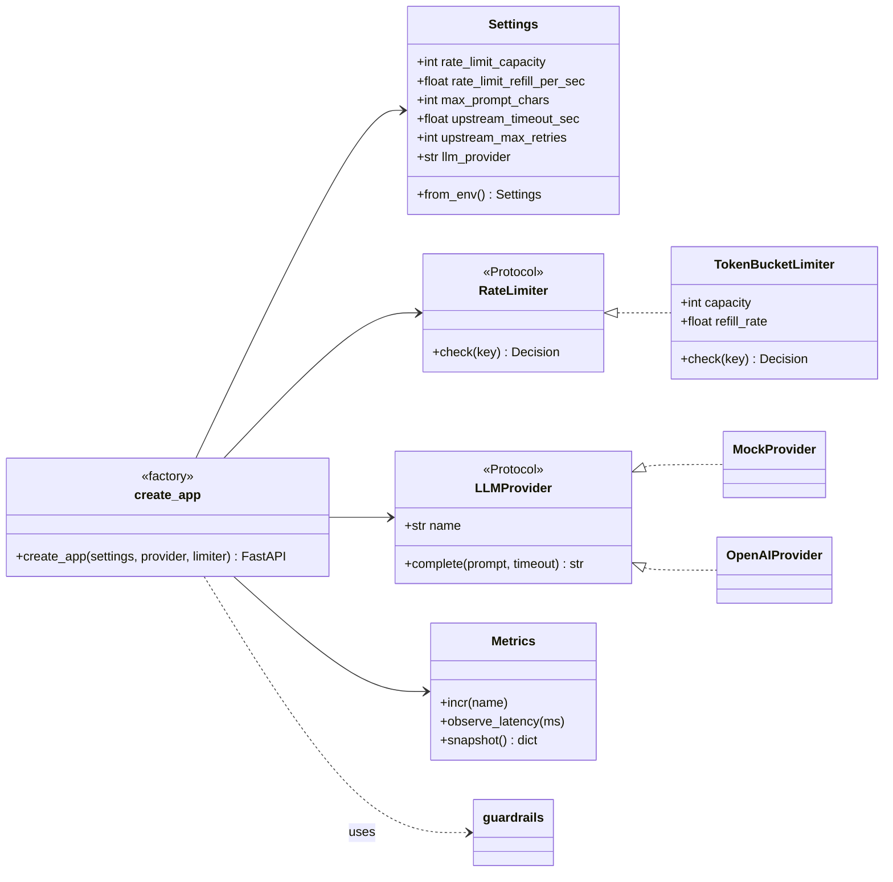

### API reference

| Method | Path | Body / headers | Responses |
|---|---|---|---|
| `POST` | `/v1/chat` | `{"prompt": "..."}`, optional `X-Client-Id` | `200` reply · `400` guardrail · `429` rate limit · `502` upstream |
| `GET` | `/metrics` | – | `200` counters, success rate, latency percentiles |
| `GET` | `/health` | – | `200` status, provider, version |
| `GET` | `/docs` | – | Interactive OpenAPI (Swagger) UI |

### Configuration

All settings come from environment variables (see `.env.example`):

| Variable | Default | Meaning |
|---|---:|---|
| `LLM_PROVIDER` | `mock` | `mock` or `openai` |
| `RATE_LIMIT_CAPACITY` | `20` | Burst size per client |
| `RATE_LIMIT_REFILL_PER_SEC` | `1.0` | Sustained requests/sec per client |
| `MAX_PROMPT_CHARS` | `4000` | Input length limit |
| `UPSTREAM_TIMEOUT_SEC` | `30` | Per-attempt provider timeout |
| `UPSTREAM_MAX_RETRIES` | `2` | Retries after the first attempt |

---

## Testing

```bash
ruff check .
pytest --cov=app
```

**25 tests, 96% line coverage.** No network access or API key needed.

| Test file | What it verifies |
|---|---|
| `test_rate_limiter.py` | Burst up to capacity, refill over time, never exceeds capacity after idle, per-client isolation, invalid config rejected. A fake clock makes time deterministic |
| `test_guardrails.py` | Email + phone redaction, ordinary numbers left alone, empty / oversized / injection prompts blocked, output redaction |
| `test_llm_client.py` | Retry then succeed, exact backoff delays (0.5 s, 1 s), raise after exhausting retries, provider factory |
| `test_api.py` | End-to-end `200 / 400 / 429 / 502` paths, PII redacted in both directions, per-client rate limits, metrics reflect traffic |

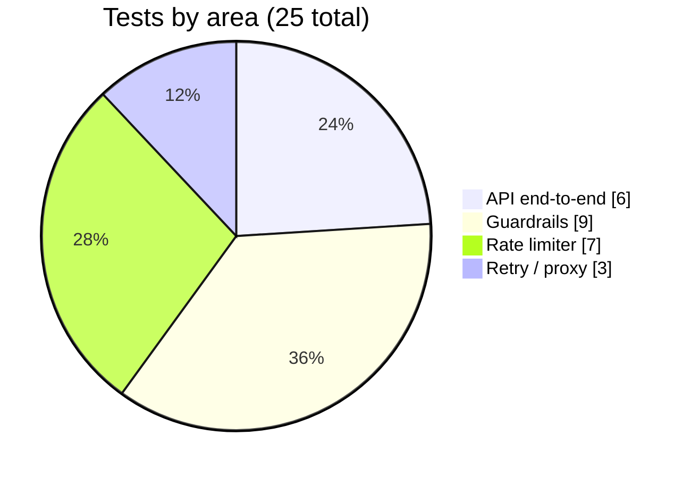

---

## CI/CD

Every push and pull request to `main` runs GitHub Actions (`.github/workflows/ci.yml`):

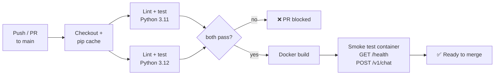

### Branching workflow

Work happens on short-lived feature branches and is merged through pull requests. The [PR template](.github/pull_request_template.md) asks for tests and a no-secrets check.

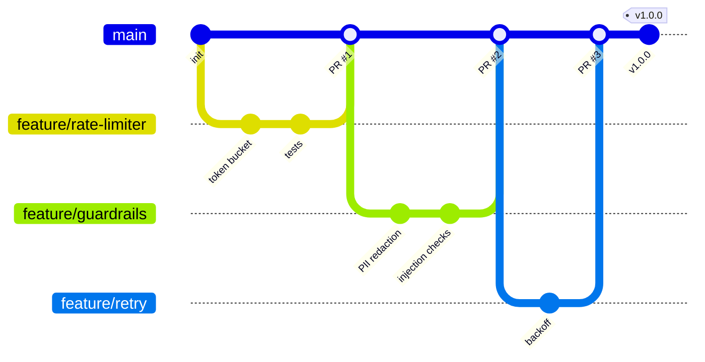

---

## Deployment

The service ships as a small, non-root Docker image with a built-in health check.

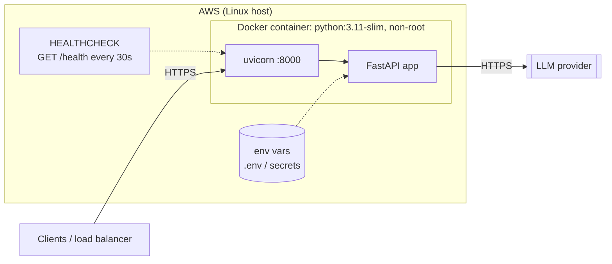

| Choice | Reason |
|---|---|
| `python:3.11-slim` base | Small image, fast pulls |
| Non-root `appuser` | Limits damage if the process is compromised |
| `HEALTHCHECK` on `/health` | The orchestrator restarts unhealthy containers automatically |
| Config via env vars | Same image across dev, staging and prod; secrets stay out of the image |
| `.dockerignore` excludes tests, docs, `.env` | Smaller image, no secrets baked in |

---

## Key takeaways

1. **LLM reliability is backend engineering.** Rate limits, timeouts, retries and validation do more for uptime than prompt tweaks.
2. **Reject early.** The cheapest LLM call is the one you never make. Limits and guardrails run before the provider is touched.
3. **Guard both directions.** PII can come back in the model's answer, not just go out in the prompt.
4. **Interfaces make it testable.** Injecting the provider, limiter and clock means the whole service is tested offline in under a second.
5. **If you don't measure it, you can't run it.** Success rate and tail latency are what tell you whether you're meeting an uptime target.

---

## My contributions

<!-- Edit to reflect your exact role -->

**On the client platform**

- Built an AI-driven **sales intelligence and employee management system** with **real-time dashboards**, **analytics pipelines** and **multi-agent LLM workflows** behind a ChatGPT-style chat interface
- Built a **conversational voice AI agent** for lead generation and CRM, with streaming speech-to-text and text-to-speech
- Reached **99.5% uptime** in production using a **rate limiter and proxy server**, with automated monitoring of LLM performance and guardrails
- **Reduced manual effort by ~60%** by automating performance monitoring, territory-risk analysis and executive reporting

**In this repository**

- Designed and implemented the gateway from scratch: token-bucket limiter, two-way guardrails, provider proxy with exponential backoff, metrics
- Wrote **25 unit tests (96% coverage)** with injected clocks and fake providers so the suite runs offline
- Set up **CI/CD**: Ruff + pytest on a Python version matrix, Docker build and container smoke test, PR template

**Skills:** Python · FastAPI · REST API design · Software design patterns (dependency injection, interfaces) · Unit testing (pytest) · CI/CD (GitHub Actions) · Docker · Linux · AWS · LLM integration · Reliability engineering · Agile / Git branching workflow

---

## Future work

- **Distributed rate limiting** with a Redis-backed `RateLimiter` (atomic Lua script) for several gateway instances
- **Circuit breaker** that stops calling a provider that is clearly down and recovers automatically
- **Response caching** for repeated prompts to cut cost and latency
- **Prometheus / OpenTelemetry** export with Grafana dashboards and alerting
- **Per-tenant token budgets**: limit by LLM tokens used, not just request count
- **Provider fallback**: route to a second model when the primary fails

---

## Repository structure

```text
ai-sales-intelligence-showcase/
│
├── app/
│   ├── main.py              # FastAPI app + request pipeline (create_app factory)
│   ├── rate_limiter.py      # Token-bucket limiter (RateLimiter protocol)
│   ├── guardrails.py        # Input/output checks, PII redaction
│   ├── llm_client.py        # LLMProvider protocol, mock + OpenAI providers, retry
│   ├── monitoring.py        # Counters + latency percentiles
│   └── config.py            # Env-based settings
├── tests/                   # 25 unit + API tests
├── assets/
│   ├── pipeline.png         # Platform overview (hero image)
│   ├── token_bucket.png     # Rate-limiter simulation
│   └── src/                 # Sources to regenerate both figures
├── docs/architecture.md     # Design decisions in more depth
├── .github/
│   ├── workflows/ci.yml     # Lint, test matrix, Docker build + smoke test
│   └── pull_request_template.md
├── Dockerfile
├── requirements.txt / requirements-dev.txt
└── README.md
```

---

## Quick start

```bash
git clone https://github.com/medhairya/ai-sales-intelligence-showcase.git
cd ai-sales-intelligence-showcase
python -m venv .venv && source .venv/bin/activate
pip install -r requirements-dev.txt

uvicorn app.main:app --reload          # open http://localhost:8000/docs
```

Try it:

```bash
curl -X POST localhost:8000/v1/chat \
  -H "Content-Type: application/json" -H "X-Client-Id: sales-team" \
  -d '{"prompt": "Summarise this week for the rep at priya@example.com"}'
# -> reply with the email redacted, "redactions": ["EMAIL"]

curl localhost:8000/metrics
```

To use a real model, set `LLM_PROVIDER=openai` and `OPENAI_API_KEY` (see `.env.example`).

**Docker**

```bash
docker build -t llm-gateway .
docker run -p 8000:8000 llm-gateway
```

**Regenerate the figures**

```bash
python assets/src/token_bucket_plot.py                 # needs matplotlib
pdflatex -output-directory assets/src assets/src/pipeline.tex
pdftoppm -png -r 200 -singlefile assets/src/pipeline.pdf assets/pipeline
```

---

<p align="center">
  <i>The goal: LLM features that behave like the rest of a production system. <b>Limited</b>, <b>validated</b>, <b>observable</b> and <b>boring to operate</b>.</i>
</p>
