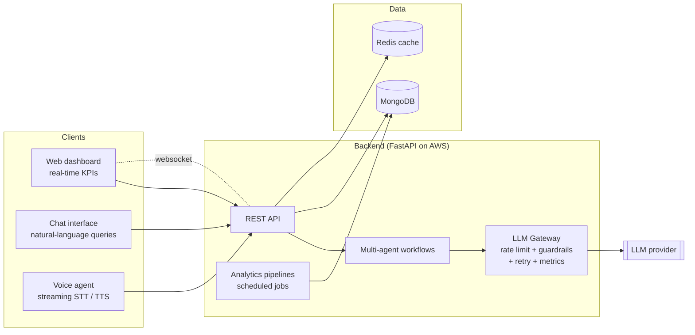
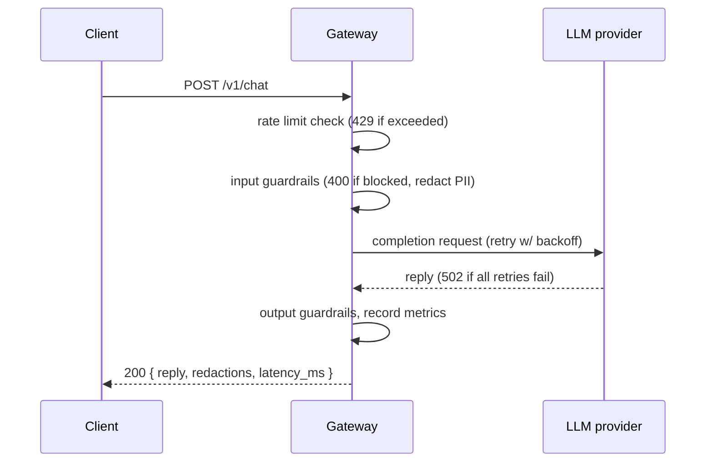

# Architecture

High-level view of the client platform. Component names are generic; no client
systems, schemas or data are shown.

## What lives in this repo

Only the **LLM Gateway** box above is published here, as a clean-room
reimplementation:

| Module | Responsibility |
|---|---|
| `app/rate_limiter.py` | Per-client token bucket: bursts allowed, sustained rate capped |
| `app/guardrails.py` | Blocks empty, oversized and prompt-injection inputs; redacts PII in and out |
| `app/llm_client.py` | Provider interface (proxy layer) with exponential-backoff retries |
| `app/monitoring.py` | Request counters, success rate, p50/p95/p99 latency |
| `app/main.py` | FastAPI app wiring the above into `POST /v1/chat` |

## Request lifecycle

## Design decisions

- **Token bucket over fixed window**: avoids the burst-at-window-edge problem
  and lets genuine users send a few quick messages without being throttled.
- **Provider interface**: business logic never imports a vendor SDK, so the
  upstream model can be switched or mocked (CI runs fully offline).
- **Guardrails both ways**: PII is stripped before it leaves the network and
  again from model output, since models can echo data from context.
- **Dependency injection in `create_app`**: tests swap in fake providers,
  limiters and settings without patching globals.
